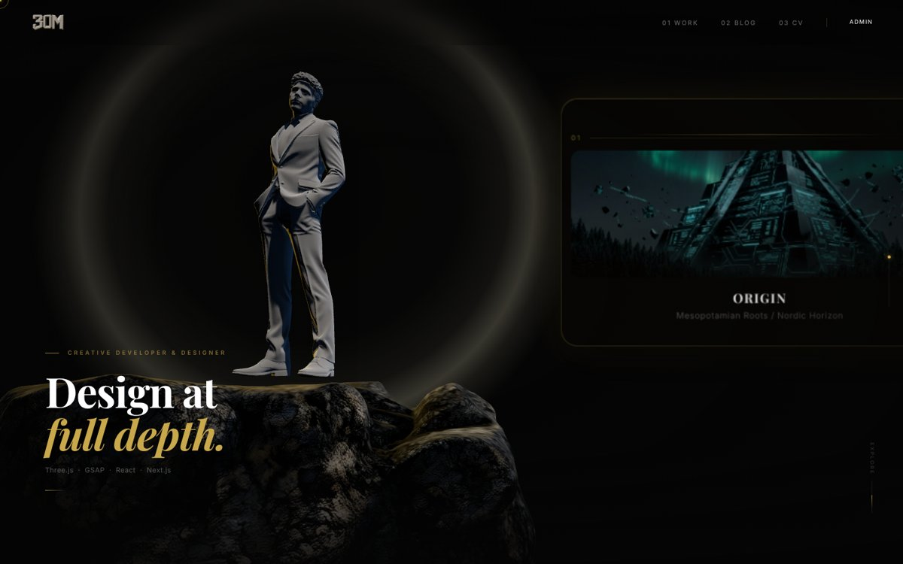
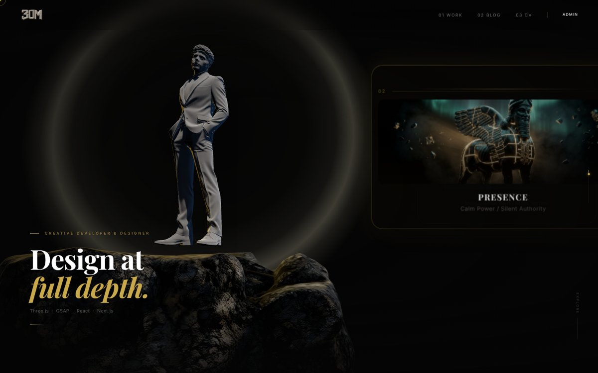

<div align="center">

# 3D Portfolio

Personlig porteføljeside med interaktiv 3D-scene, animert scrolling og eget backend for innhold.


</div>



> [!NOTE]
> Prosjektet er under utvikling. Skjermbildene er tatt fra en lokal kjøring uten backend, så innholdet på enkelte sider er eksempeldata.

## Om prosjektet

En porteføljeside der hovedfokuset er en filmatisk 3D-opplevelse i nettleseren: en 3D-modell i en opplyst scene, kort som skifter mens man scroller, og myke overganger mellom sidene. I tillegg har siden et eget Express-backend og et adminpanel for å publisere prosjekter og blogginnlegg.

## Funksjoner

| Område | Hva det gjør |
| --- | --- |
| 🧊 **3D-scene** | Three.js via React Three Fiber og Drei, med egne lys og 3D-modeller (GLB) |
| 🎞️ **Animasjon** | Scroll-animasjoner med GSAP og Lenis, sideoverganger med Framer Motion |
| 📁 **Sider** | Forside, prosjekter, blogg, CV og kontakt |
| 🔐 **Adminpanel** | Innlogging og dashboard for å opprette, endre og slette prosjekter og innlegg |
| 🖼️ **Bilder** | Bildeopplasting til Cloudinary fra adminpanelet |
| ⚡ **Ytelse** | 3D-modellene er komprimert med Draco for raskere lasting |
| 🛟 **Reserve** | Frontend viser eksempeldata hvis backend ikke svarer |



## Teknisk oppbygning

| Del | Teknologi |
| --- | --- |
| Frontend | Next.js 14 (App Router), React, TypeScript, Tailwind CSS |
| 3D og animasjon | Three.js, React Three Fiber, Drei, GSAP, Lenis, Framer Motion |
| Backend | Node.js og Express (`server/`) |
| Database | MongoDB med Mongoose-modeller for brukere, prosjekter og innlegg |
| Tilgang | JWT-innlogging, beskyttede ruter for admin |
| Filer og analyse | Cloudinary for bilder, PostHog (valgfritt) |

### API

| Metode | Endepunkt | Tilgang |
| --- | --- | --- |
| POST | `/api/auth/login` | Åpen |
| GET | `/api/projects`, `/api/projects/:id` | Åpen |
| POST · PUT · DELETE | `/api/projects` | Krever innlogging |
| GET | `/api/posts`, `/api/posts/:idOrSlug` | Åpen |
| POST · PUT · DELETE | `/api/posts` | Krever innlogging |
| POST | `/api/projects/upload/image`, `/api/posts/upload/image` | Krever innlogging |

## Kjør lokalt

```bash
npm install
cp .env.local.example .env.local
npm run dev          # bare frontend, med eksempeldata
npm run dev:all      # frontend + Express-backend
```

For backend trengs en MongoDB-tilkobling og en `JWT_SECRET` i `server/.env` (se `.env.local.example`).

## Videre arbeid

- Ekte innhold og bilder i prosjekter og blogg
- Publisere frontend og backend
- Mobiltilpasning og tester

---

<div align="center">

**Ali Badr Almrabhi** · Vg2 IT-utvikling · [GitHub](https://github.com/AliPluss) · [LinkedIn](https://www.linkedin.com/in/ali-badr-a-a-almrabhi-5676b9448/)

</div>
